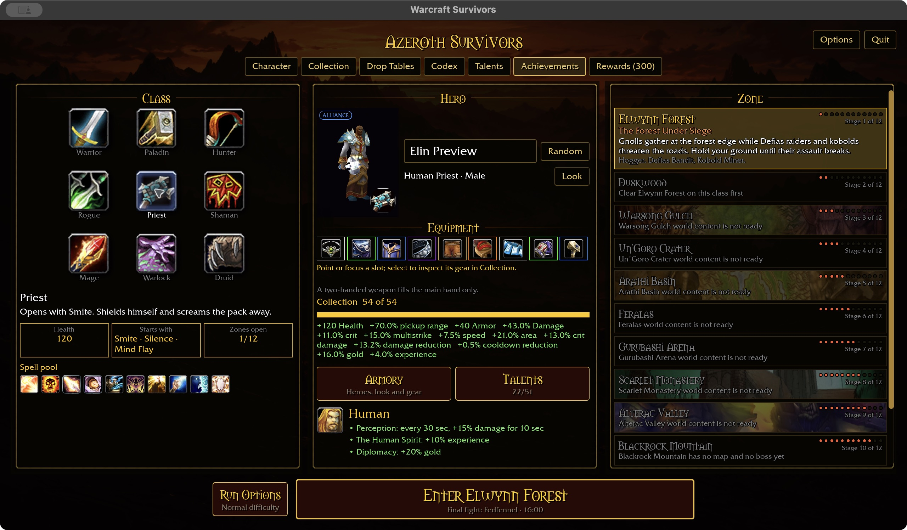
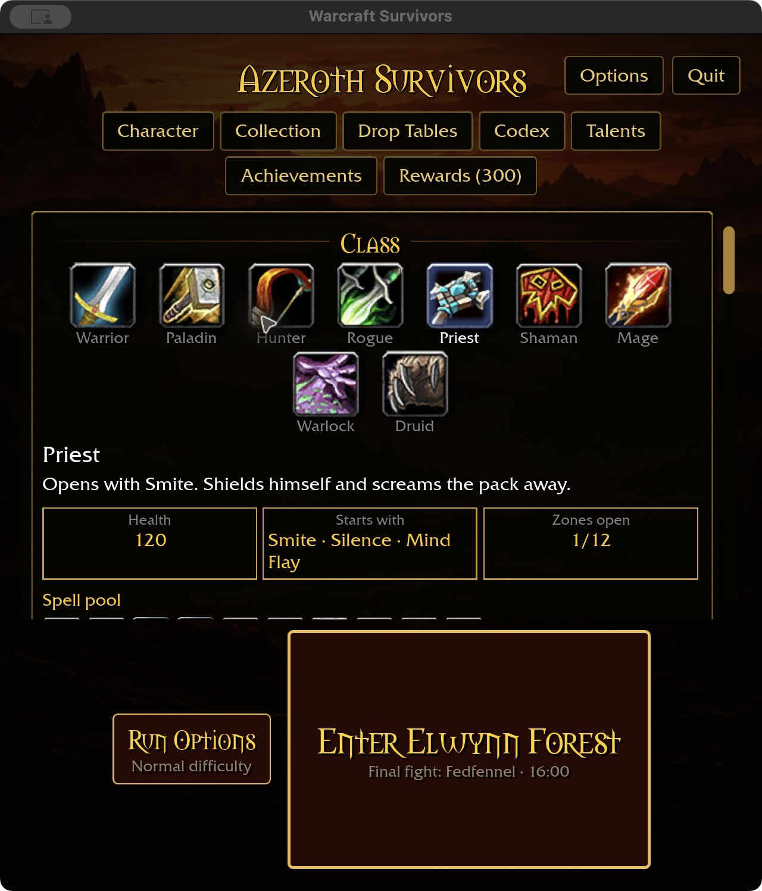
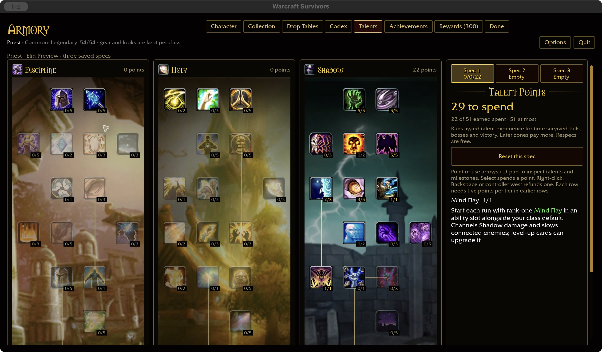
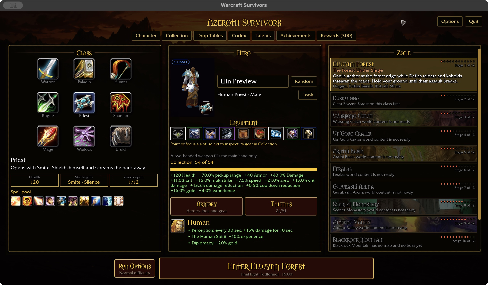
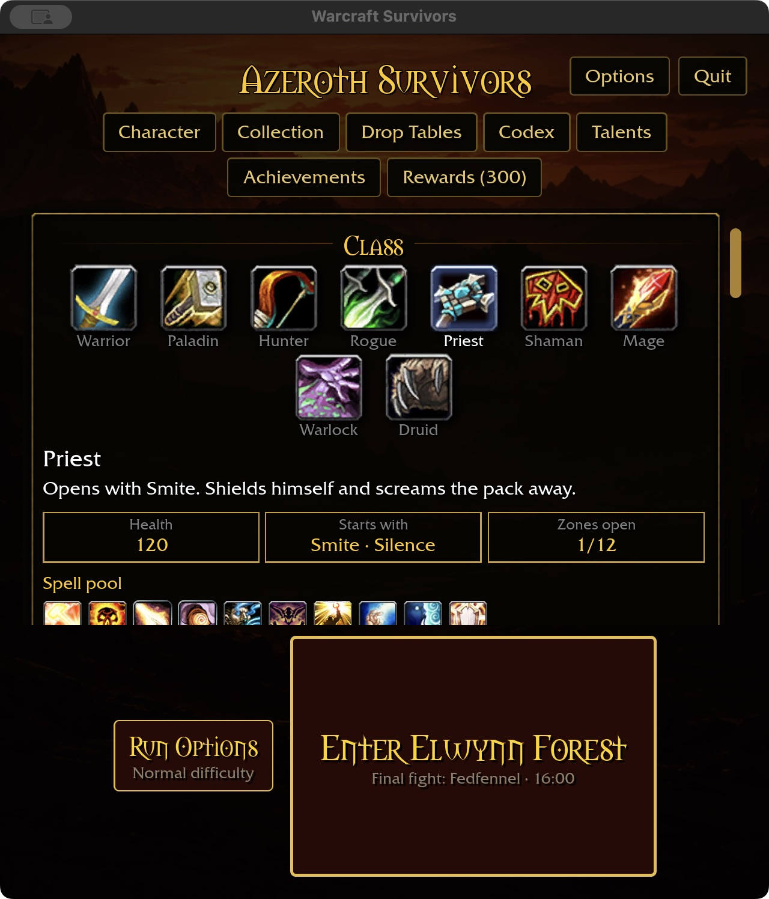
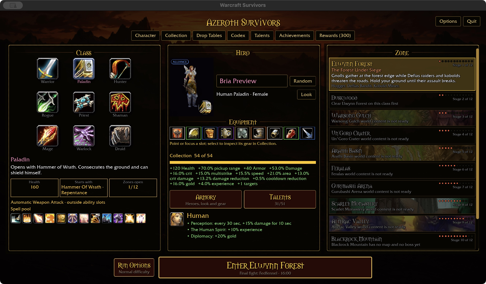
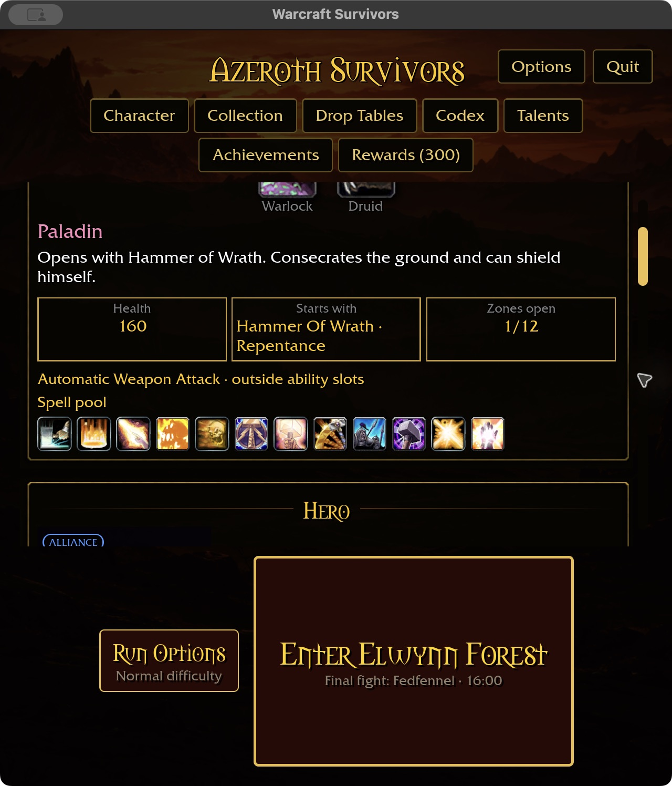
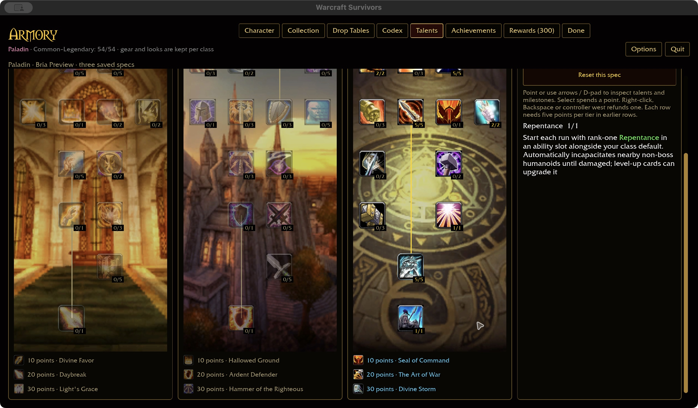
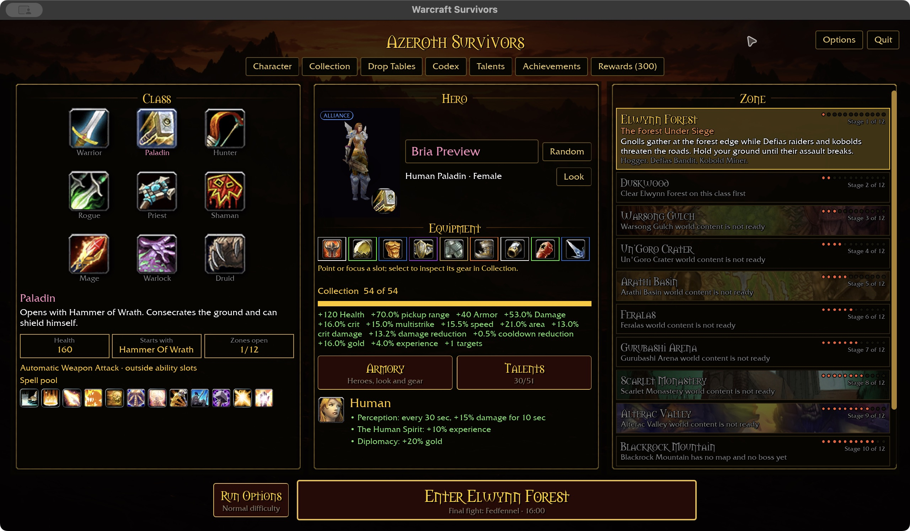
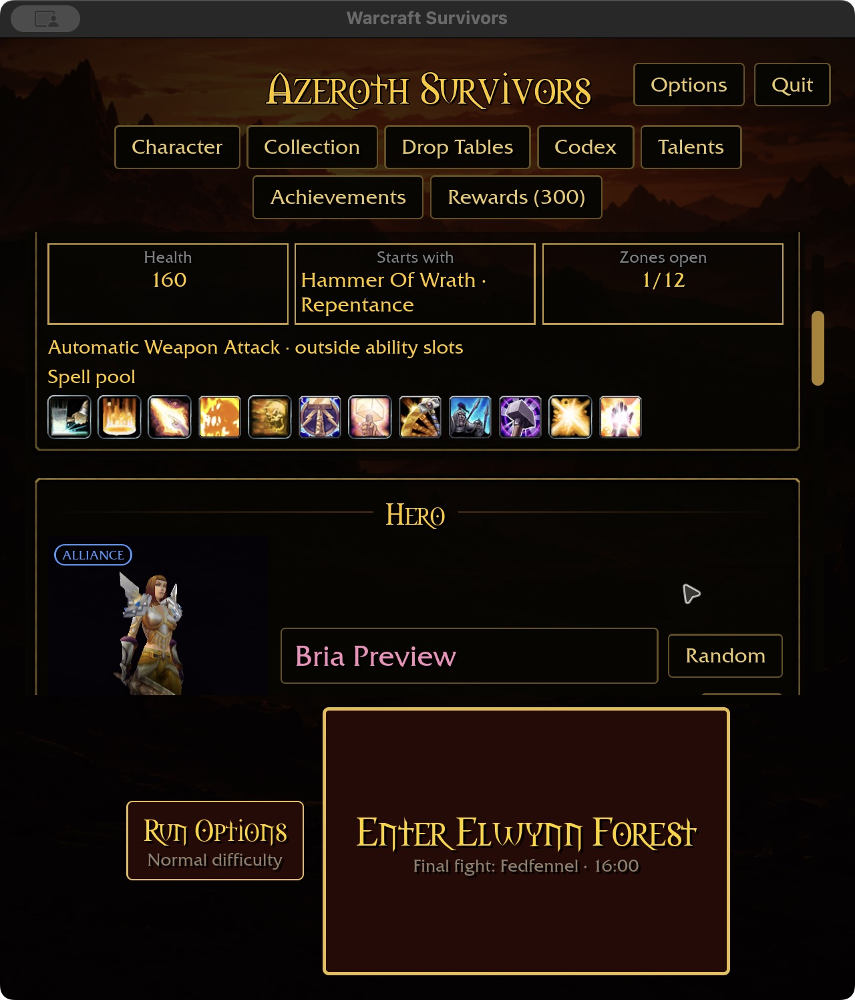

# Tree-granted starting abilities — 2026-11-01

Implements the approved starting-kit rule for the three existing explicit
ability-unlock talents: Priest Mind Flay/Silence and Paladin Repentance. Training
now grants rank one at run start alongside the class default, instead of merely
unlocking a future random card. A fully trained Priest starts with Smite, Silence
and Mind Flay; Paladin starts with Hammer of Wrath and Repentance. Automatic
weapon attacks remain separate and use no ability slot.

## Shared behavior

`Milestones::starting_abilities` supplies both the starter's “Starts with” list
and `Run::finish_start`. Mouse entry, keyboard entry and the production selected-run
preview already call that common initialization after obtaining the selected
spec snapshot. Each newly granted spell starts at rank one with the existing
0.5-second initial recovery. Existing owned entries are not duplicated. Foreign
class snapshots cannot grant spells. Refund/spec changes affect subsequent runs;
existing run snapshots are not rewritten. No save-format change is required.

The catalog regression checks all classes and all currently defined unlocks fit
three starting slots. Future additions that exceed this limit must implement an
explicit replacement/redesign policy; do not truncate learned spells in catalog
order or add an overflow selection menu. Level-up offers upgrade owned spells and cannot acquire a seventh ability.
Other talent conversions, new feral abilities and broader melee automatic attacks
remain work. Definition coverage stays 319/432 plus three authored form nodes.
The [approved combat policy](../SURVIVORS-COMBAT-POLICY.md) governs subsequent grants and redesigns.

## Evidence and limits

Shared tests cover empty/trained/refunded kits, wrong classes, uniqueness and the
three-slot bound. App tests cover startup, initial rank/recovery, duplicate
prevention, independent subsequent specs, and upgrade offers at the six-slot cap.

Native macOS production preview uses isolated fixture
`target/ui-fixtures/starting-talents-20261101`, seeded before launch. The three-spell
Priest kit is readable at 1280×720 / 100% and 640×720 / 125%. Native right-click
refund of Mind Flay removes it from the starter; compact restart preserves the
remaining Smite/Silence kit. The revised talent description highlights Mind Flay
in green. No gameplay was launched. Paladin runtime initialization is regression
tested; native Paladin presentation is verified below. Windows and attended combat remain open.

Validation: 360 shared-rule tests, the ten-package scoped gate and final
same-scope all-target Clippy/format checks pass. There are 31 optional-addon
corpus skips. Native play build (45.22 seconds) and WebGPU check pass with the
existing linker unwind warning and six WebGPU warnings. Generated storage:
57.05 GiB; caches preserved. Full landing gates remain required before merge.

## Paladin native starter acceptance — 2026-11-01

The isolated `target/ui-fixtures/paladin-starting-talents-20261101` profile uses
Bria Preview, Human female Paladin, with 30 prerequisite Retribution points and
Repentance trained. Wide 1280×720 / 100% and compact 640×720 / 125% show Hammer
of Wrath plus Repentance, with Automatic Weapon Attack explicitly outside slots.
The compact content scrolls to reveal both labels without overlapping text.

Native right-click refund changes Repentance 1/1 to 0/1, reduces spent points
31 to 30 and removes it from the starter list; the automatic attack remains.
Native repurchase restores rank one; closing/restarting the compact preview
preserves the two-spell starter and separate automatic attack. The saved `dbc 2`
record contains `2:1441:1` after repurchase. No account edits were used for these
transitions; prerequisites were seeded before the original preview launch.

Compared against `docs/intentions/survivors_main_menu.png`: the wide view retains
Class/Hero/Zone columns, navigation, equipment and bottom run controls. Compact
layout wraps navigation and scrolls content. This verifies the starting-kit
presentation, not complete pixel matching or every starter control.

This documentation-only follow-up uses the existing starter-grant preview binary
built before the disarm-removal checkpoint; its embedded build stamp is stale
(`8e9103c`), so the observed UI/save behavior is the evidence, not that stamp.
No new source/build changes. The latest scoped gate/native/WebGPU checks remain
applicable to the codebase; this preview does not validate disarm removal.
Storage: 57.36 GiB. Windows, controller, Paladin spec switching in this starter
flow and attended combat remain open. Normal launcher restored after confirmed exit.

