# Native wide/short talents — 2026-10-30

Runtime code: `2c7ee86`. Native macOS production UI, isolated `collected`
fixture (Warrior Alden Preview, 51 unspent points), checkout `wow-data/Data`.
Reference: [talent intention](../intentions/survivors_talent_tab.png).
This supplements the earlier browser ultrawide evidence; it does not replace it.

At 1440×600 / 125%, the three illustrated trees and right-hand spec panel
retain their horizontal arrangement. Icons and rank labels remain separated;
vertical scrolling preserves the taller artwork rather than squeezing seven
rows into the short viewport. The sticky inspector remains readable while
scrolling. The reference depicts Paladin, so this establishes layout alignment,
not identical class artwork.

Selecting locked Shield Slam shows its Concussion Blow prerequisite and green
inline scaling. It remains rank 0/1. Scrolling to the bottom exposes all three
capstones and all nine milestone labels without horizontal clipping.

Changing the watched preset to 100% and scrolling back up preserves three
empty specs and all 51 unspent points. The inspector returns to the side panel.

Reproduce with `survivors-ui-fixture.py collected` and the new
`talents-1440x600-125.txt` / `talents-1440x600-100.txt` presets. Scroll with the
pointer; End did not move this talent page and is not counted as keyboard
acceptance here. No purchases, combat or player saves were involved. The app
was quit, its process exit confirmed, and the validation launcher restored.

No runtime code changed. The prior native build and scoped gate at `2c7ee86`
remain applicable; they were not rerun for screenshots/docs. Windows, physical
controllers, other classes at this size and the remaining resolution matrix
are still open. Startup/interaction hitch warnings occurred in this run; these
screenshots establish layout and reachability, not frame-time acceptance.

## Complete class layout matrix — 2026-10-30

Native follow-up on the same runtime code now covers the other eight classes
at **1440×600 / 125%**, using collected fixture heroes 2–9. Each page was read
at the top and scrolled to its bottom. All three class-specific tree headings,
art backgrounds, top-row rank labels, capstones and nine milestone labels are
visible without horizontal clipping. Each top capture shows 51 unspent points
and three empty specs; this pass performs no talent purchase.

Paladin's cathedral, city and rune-circle backgrounds match the reference's
art identities. Its actual 1.12 node arrangement differs from the illustrative
reference; this check does not assert identical talent placement or mechanics.
The other classes use their own art and seven-row grids. Switching heroes
through the watched preview starts each previously unvisited tree at the top.

Reproduce with the existing `talents-1440x600-125.txt` preset and `--hero N
--spec 1` using `scripts/survivors-ui-fixture.py collected`; fixture IDs 1–9
follow Warrior, Paladin, Hunter, Rogue, Priest, Shaman, Mage, Warlock, Druid.
The prior Warrior screenshots complete the nine-class matrix at this one size.

Paladin: top and complete milestone footer

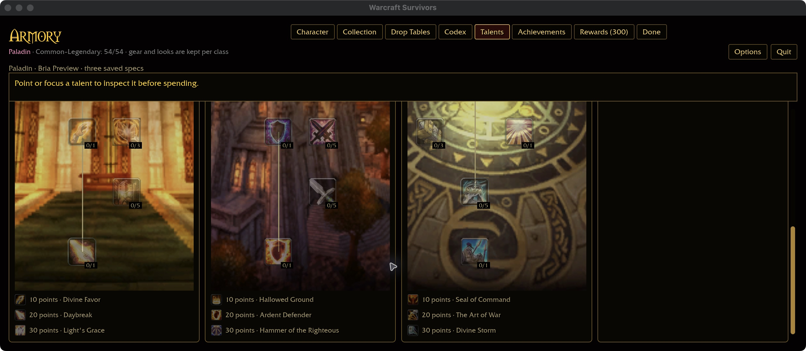

Hunter: top and complete milestone footer

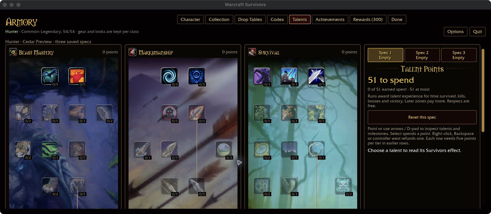

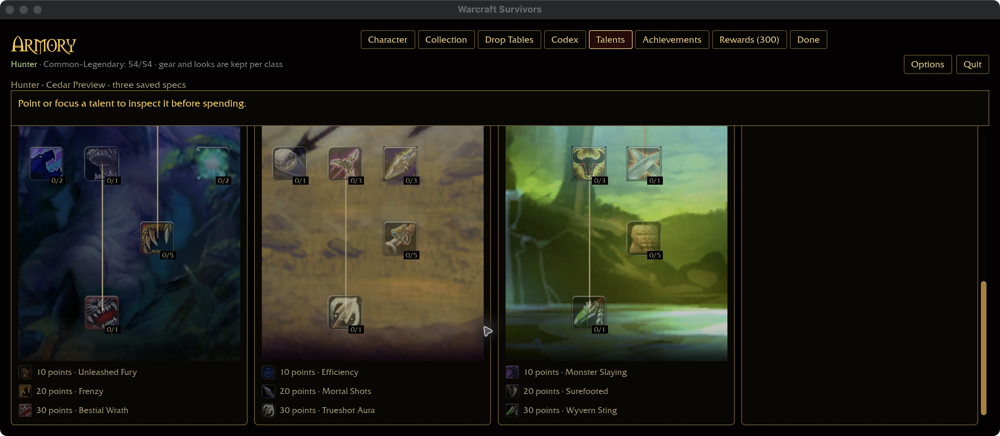

Rogue: top and complete milestone footer

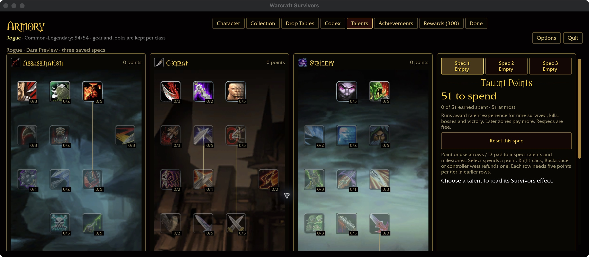

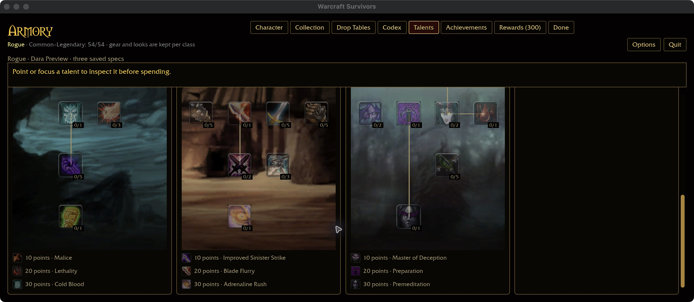

Priest: top and complete milestone footer

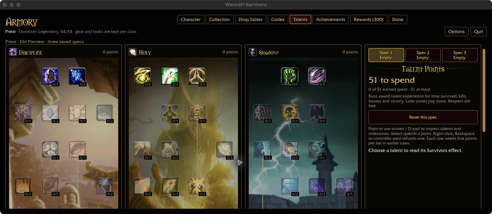

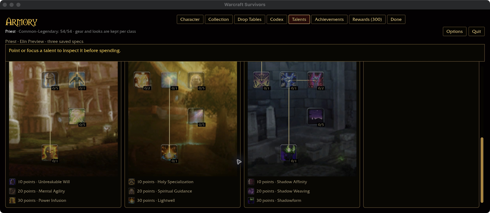

Shaman: top and complete milestone footer

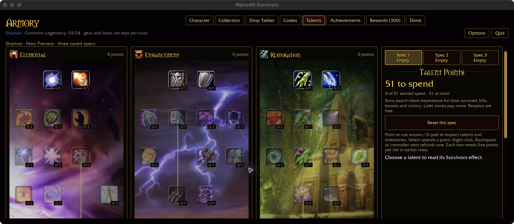

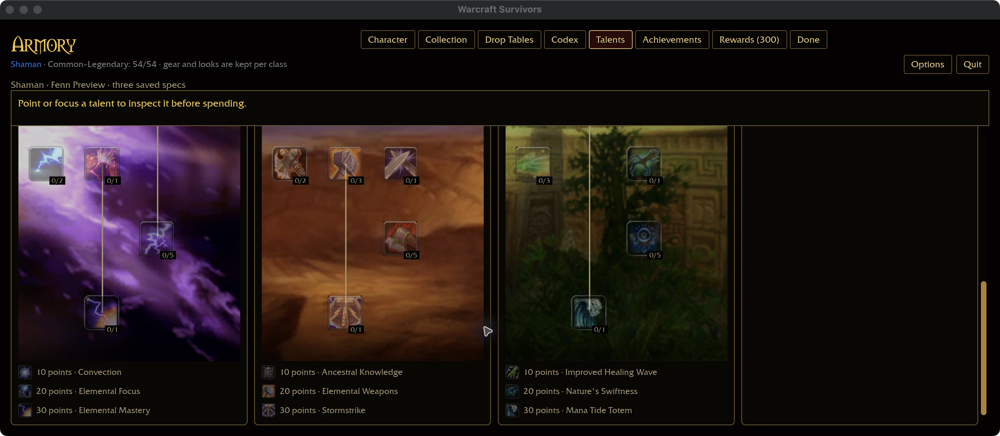

Mage: top and complete milestone footer

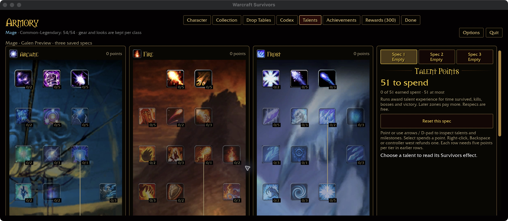

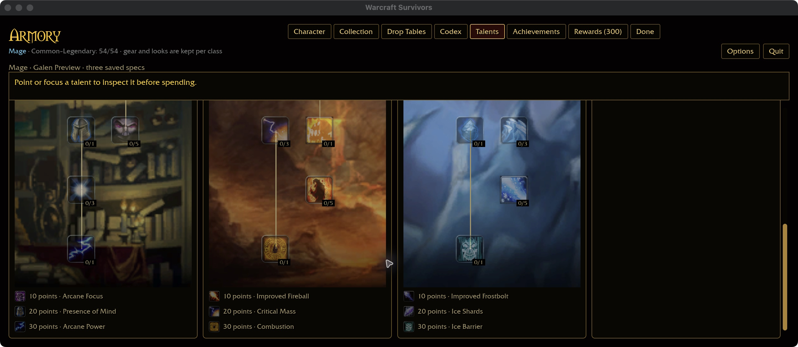

Warlock: top and complete milestone footer

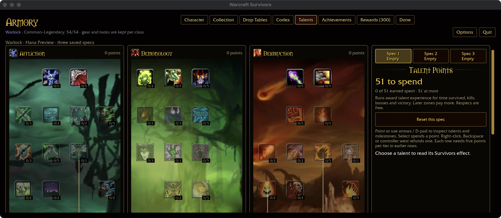

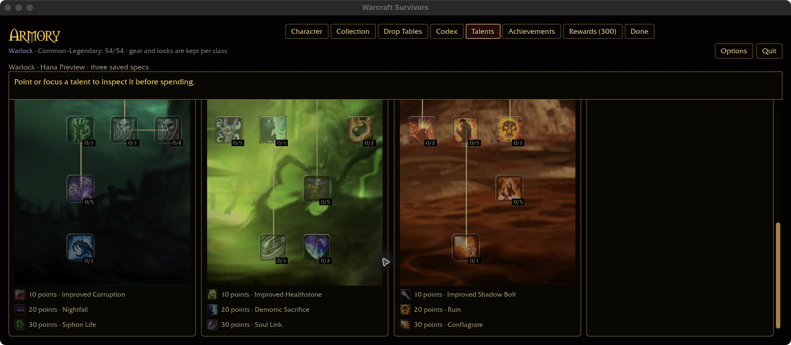

Druid: top and complete milestone footer

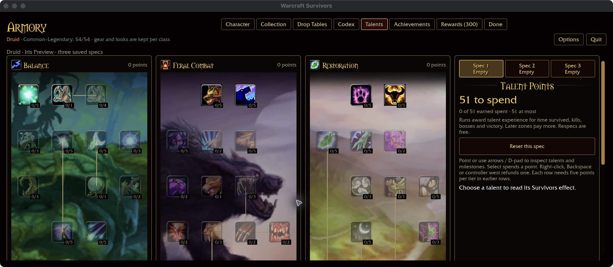

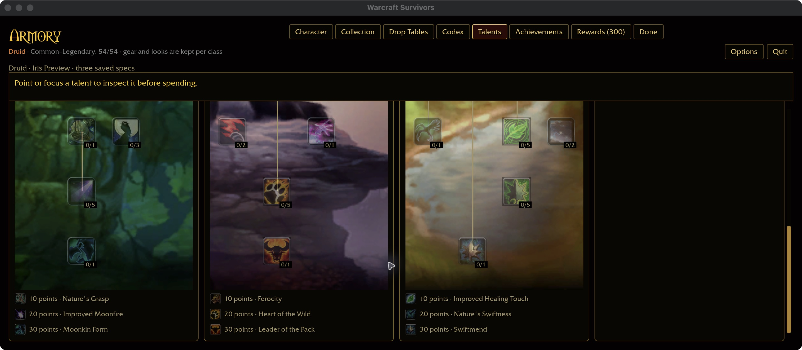

This supersedes the earlier “other classes at this size” limitation only for
macOS 1440×600 / 125% layout and pointer scrolling. Other sizes/scales, Windows,
controllers, full tooltip coverage, purchases and combat remain separate.
No runtime code or talent-coverage count changed. The app exited and its
launcher was restored. The existing source gate remains applicable.
