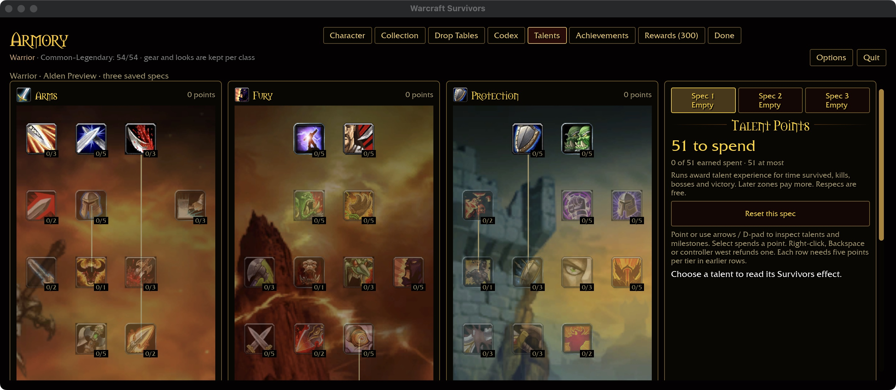
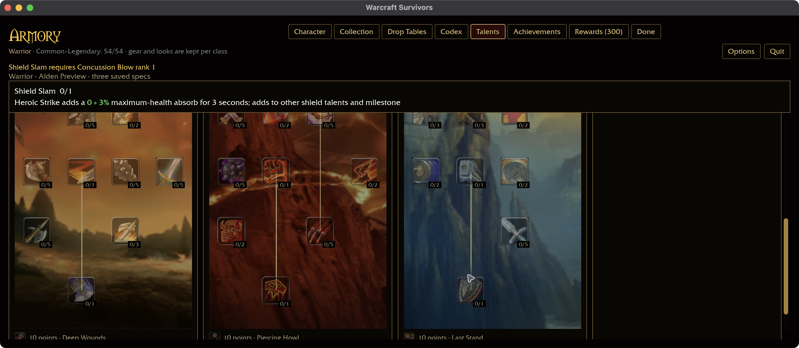
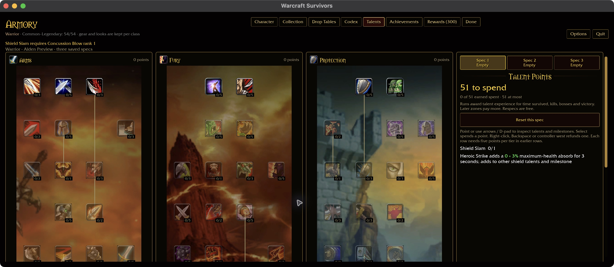

# Native wide/short talents — 2026-10-30

Runtime code: `2c7ee86`. Native macOS production UI, isolated `collected`
fixture (Warrior Alden Preview, 51 unspent points), checkout `wow-data/Data`.
Reference: [talent intention](../intentions/survivors_talent_tab.png).
This supplements the earlier browser ultrawide evidence; it does not replace it.

At 1440×600 / 125%, the three illustrated trees and right-hand spec panel
retain their horizontal arrangement. Icons and rank labels remain separated;
vertical scrolling preserves the taller artwork rather than squeezing seven
rows into the short viewport. The sticky inspector remains readable while
scrolling. The reference depicts Paladin, so this establishes layout alignment,
not identical class artwork.

Selecting locked Shield Slam shows its Concussion Blow prerequisite and green
inline scaling. It remains rank 0/1. Scrolling to the bottom exposes all three
capstones and all nine milestone labels without horizontal clipping.

Changing the watched preset to 100% and scrolling back up preserves three
empty specs and all 51 unspent points. The inspector returns to the side panel.

Reproduce with `survivors-ui-fixture.py collected` and the new
`talents-1440x600-125.txt` / `talents-1440x600-100.txt` presets. Scroll with the
pointer; End did not move this talent page and is not counted as keyboard
acceptance here. No purchases, combat or player saves were involved. The app
was quit, its process exit confirmed, and the validation launcher restored.

No runtime code changed. The prior native build and scoped gate at `2c7ee86`
remain applicable; they were not rerun for screenshots/docs. Windows, physical
controllers, other classes at this size and the remaining resolution matrix
are still open. Startup/interaction hitch warnings occurred in this run; these
screenshots establish layout and reachability, not frame-time acceptance.
